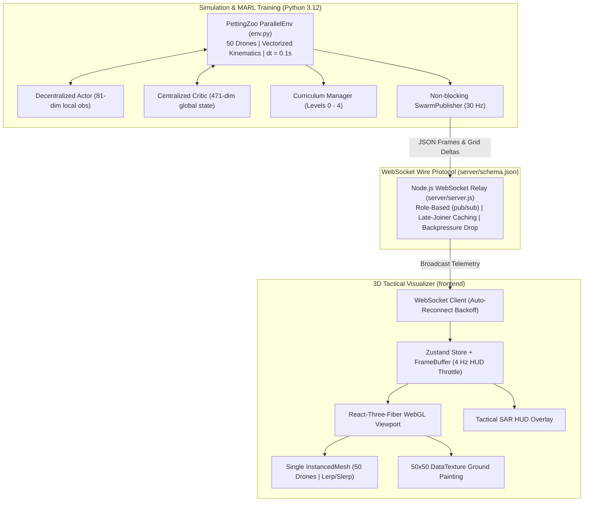

# SwarmRL: 50-Agent Autonomous Drone Swarm Search-and-Rescue Simulator

SwarmRL is an end-to-end multi-agent reinforcement learning (MARL) search-and-rescue platform featuring 50 autonomous drones operating inside a continuous 3D world ($[-50, 50]\times[0, 20]\times[-50, 50]\text{ m}$). The system implements Centralized Training with Decentralized Execution (CTDE) using True MAPPO on Ray RLlib's New API Stack, streaming live 30 Hz simulation telemetry through a high-throughput Node.js WebSocket relay to a 60 FPS React-Three-Fiber 3D WebGL tactical frontend with real-time ground exploration painting.

---

## System Architecture



---

## Quickstart

### 1. Installation

```bash
# Clone repository
git clone https://github.com/vedantdubey19/SwarmRL.git
cd SwarmRL

# Create and activate Python 3.12 environment
conda create -n swarmrl python=3.12 -y
conda activate swarmrl
pip install -r requirements.txt -r requirements-dev.txt

# Install Node dependencies (relay, test harness, and frontend)
npm ci
npm ci --prefix server
npm ci --prefix frontend
```

> **Note on Developer Mock Feed**: `scripts/mock_feed.js` is an explicit dev/test tool requiring `--mock` (`node scripts/mock_feed.js --mock`). It is not part of the live telemetry path.

### 2. Run Comprehensive Verification Gate

Run the master verification pipeline to run all phase checks and benchmarks:

```bash
python scripts/verify_all.py
```

### 3. MAPPO Training

Launch multi-runner MAPPO training on the RLlib New API Stack with curriculum progression:

```bash
python training/train.py --iterations 20 --num-runners 2
```

Evaluate the trained policy checkpoint against the random baseline:

```bash
python training/evaluate.py --checkpoint checkpoints/best_checkpoint --benchmark --episodes 10
```

### 4. Live Simulation & 3D Visualizer

Run the three services concurrently:

```bash
# Terminal 1: Start WebSocket Relay Server
node server/server.js

# Terminal 2: Start React-Three-Fiber Frontend
cd frontend && npm run dev

# Terminal 3: Launch Live Simulator Bridge
python scripts/run_live_sim.py --checkpoint checkpoints/best_checkpoint --hz 30
```

Open `http://localhost:5173` in your browser to view the 50-drone swarm actively exploring and recovering targets in real time.

---

## Key Design Decisions

1. **Why PettingZoo ParallelEnv**:
   PettingZoo's `ParallelEnv` executes step updates simultaneously across all 50 drones via unified NumPy matrix broadcasting (`detect_drone_collisions_vectorized`, batch cone sensor checks). This eliminates slow Python double-loops, yielding **>1100 steps/s** throughput and providing deterministic step synchronization.

2. **Why RLlib New API Stack**:
   RLlib's new API stack decouples actor-critic networks through `TorchRLModule` and `MultiRLModuleSpec`. We explicitly partition the `Dict` observation space: each decentralized drone policy evaluates only its private 81-dimensional local observation ($81 \to 256 \to 256 \to 4$), while the centralized value network consumes the full 471-dimensional global state ($471 \to 256 \to 256 \to 1$) for accurate advantage estimation without violating decentralized execution.

3. **Why Single InstancedMesh**:
   Rendering 50 separate 3D drone meshes with individual draw calls severely limits browser framerates. Using a single Three.js `InstancedMesh` with capacity 100 collapses drone rendering into **1 single GPU draw call**, allowing silky 60 FPS rendering on any modern hardware.

4. **Why 50x50 DataTexture Ground Painting**:
   Rather than regenerating costly dynamic plane vertices or tessellating geometry, exploration coverage is tracked on a 50x50 binary grid and mapped to a 50x50 RGBA `THREE.DataTexture`. Exploration deltas directly update the underlying `Uint8Array` in-place, enabling real-time glowing trail overlays with zero memory allocation churn.

5. **Ref-Based Frame Buffer with 4 Hz HUD Throttling**:
   React state triggers full component tree reconciliations. At 30 Hz telemetry arrival, React state updates cause severe UI jank. Incoming frames are ingested into a mutable `FrameBuffer` read directly by Three.js `useFrame` for continuous lerp/slerp interpolation, while the React HUD subscribes to a strictly throttled 4 Hz slice.

---

## Directory Structure

```text
SwarmRL/
├── env.py                      # 50-agent PettingZoo ParallelEnv & RLlib wrapper
├── sensors/                    # Vectorized sensor and reward pipeline
│   ├── rewards.py              # Single source of truth RewardConfig & calculation
│   ├── events.py               # Vectorized collision & target detection
│   ├── exploration.py          # 50x50 2m-cell symmetric exploration grid
│   ├── cone_sensor.py          # Vectorized 15m 30° cone sensor
│   ├── scenario.py             # Difficulty levels 0-4 obstacle/wind generator
│   ├── bridge.py               # Telemetry message serializer
│   └── ws_publisher.py         # Non-blocking 30 Hz WebSocket publisher
├── training/                   # True MAPPO training pipeline
│   ├── train.py                # Ray RLlib training harness
│   ├── rl_module.py            # SwarmCentralizedCriticRLModule (New API Stack)
│   ├── callbacks.py            # Checkpointing & manifest logger
│   ├── curriculum.py           # Curriculum manager & remote runner sync
│   ├── evaluate.py             # Decentralized policy evaluator & benchmark
│   └── config.yaml             # Hyperparameters
├── server/                     # Telemetry relay
│   ├── server.js               # Node.js WebSocket broker with backpressure
│   └── schema.json             # Unified wire protocol schema
├── frontend/                   # React-Three-Fiber WebGL tactical visualizer
│   ├── src/components/         # DroneMesh (InstancedMesh), Terrain, Dashboard
│   ├── src/store/              # useSwarmStore (Zustand + mutable FrameBuffer)
│   └── src/utils/              # frameBuffer, gridMapping, url
├── scripts/                    # Automation & verification scripts
│   ├── verify_all.py           # Master gate verification runner
│   ├── run_live_sim.py         # Real-time simulation stream bridge
│   ├── sweep_rewards.py        # Reward parameter sweep runner
│   └── plot_training.py        # Training progress summarizer
└── docs/                       # Specifications & architecture docs
    ├── env_spec.md             # Environment specification contract
    ├── protocol.md             # Wire protocol documentation
    ├── training.md             # MAPPO training formulation & guide
    ├── reward_validation.md    # Reward component sensitivity study
    └── known_limitations.md    # Architectural bounds and scaling limits
```
